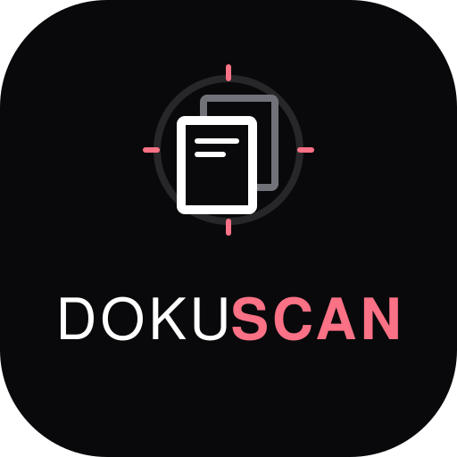

<div align="center">
  

# Doku Scan

A free, open-source document scanner for Android that works fully offline.<br>
No account, no ads, no tracking.

[**Download the APK**](https://github.com/rumman999/doku-scan/releases/latest) ·
[Website](https://rumman.is-a.dev/doku-scan/) ·
[Privacy Policy](https://rumman.is-a.dev/doku-scan/privacy.html)

</div>

Scans stay on your phone. Nothing leaves the device unless you share a PDF or turn on the optional
Google Drive backup.

## Features
- **Live edge detection**: OpenCV (WebAssembly, in a Web Worker) finds the page in the camera preview; optional auto-capture when the page holds still.
- **Perspective crop**: drag the corners (with a magnifier) and the page is flattened to a top-down scan.
- **Enhancement filters**: Enhanced (shadow removal + sharpening), Black & White, or Original.
- **Single and batch modes**: batch keeps shooting while pages process in the background.
- **Document library**: scans are saved on the device (IndexedDB). Rename, reorder, remove or add pages, view full screen, merge documents, delete.
- **PDF export**: A4 / Letter / Auto page size, quality presets, optional watermark and password; shared via the native share sheet.
- **Optional Google Drive backup**: back up to a folder in your own Drive and restore everything after reinstalling. The app can only see files it created.

## Install

1. Download `DokuScan-v*.apk` from the [latest release](https://github.com/rumman999/doku-scan/releases/latest) on your Android phone.
2. Open it and allow installs from this source when asked.
3. Install and open Doku Scan.

Requires Android 7.0 or newer.

## Development

```bash
pnpm install
pnpm dev          # http://localhost:3000 (camera works on localhost)
pnpm typecheck
pnpm build        # static export to out/ (type errors fail the build)
```

### Android

Requires JDK 21 (`JAVA_HOME`) and the Android SDK (`ANDROID_HOME`).

```bash
pnpm build
npx cap sync android
npx cap run android      # or: npx cap open android
```

Debug the app's WebView from desktop Chrome at `chrome://inspect`.

## Google Drive backup

Backups go straight from the phone to the user's own Google Drive (no server). The app uses the
`drive.file` scope, so it can only see files it created. It's a non-sensitive scope, so no Google app
review is needed.

**Users don't set anything up**: official releases include Doku Scan's Google client id
(`lib/drive/auth.ts`), so they just tap *Settings → Backup → Connect Google Drive*.

**Building it yourself?** Google only accepts sign-ins from APKs signed with a key registered to the
project, so a build signed with your own key (including a debug build) needs its own Google Cloud
project. Everything except Drive backup works without it. Setup in
[Google Cloud Console](https://console.cloud.google.com/):

1. Create (or pick) a project. **APIs & Services → Library**: enable **Google Drive API**.
2. **Google Auth Platform → Branding/Audience**: configure the consent screen (External). While it's in
   *Testing*, add your Google account under **Test users**.
3. **Data Access**: add the scope `https://www.googleapis.com/auth/drive.file`.
4. **Clients → Create client**:
   - **Android**: package `com.spycakes.dokuscan`, SHA-1 of the signing key.
     Debug key: `cd android && ./gradlew :app:signingReport` (Variant: debug → SHA1). Add another Android
     client for your release / Play signing key before publishing.
   - **Web application**: used as the server client id. For browser testing, add
     `http://localhost:3000` to *Authorized JavaScript origins*.
5. Put your **Web** client id in `.env.local` (see `.env.example`); it overrides the official one:
   `NEXT_PUBLIC_GOOGLE_WEB_CLIENT_ID=1234-abc.apps.googleusercontent.com`
6. `pnpm build && npx cap sync android`, then run the app: **Settings → Backup → Connect Google Drive**.

New Google Cloud clients can take a few minutes (occasionally hours) to start working. Error `[28444]`
on Android means the package name / SHA-1 / client type don't match.

Drive layout: `<your folder>/<document>/page-*.jpg` + `doc.json`. Deleting a document in the app moves its
Drive copy to the Drive trash (recoverable for 30 days). After reinstalling, connect and choose the
existing folder to restore.

## Release builds

Release APKs are signed with a key that is **not** in this repo. Create `android/keystore.properties`
(git-ignored):

```properties
storeFile=/absolute/path/to/release.jks
storePassword=...
keyAlias=...
keyPassword=...
```

Then `pnpm build && npx cap sync android && cd android && ./gradlew assembleRelease`. The signed APK is
`android/app/build/outputs/apk/release/app-release.apk`. Google sign-in only works for APKs signed with
a key whose SHA-1 is registered as an Android client in the Google Cloud project (see above).

## Architecture
- `app/` — screens: library (`/`), document (`/doc?id=`), scanner (`/scan`), settings.
- `lib/cv/` — detection, dewarp and filters (OpenCV.js). `lib/cv/worker.ts` is bundled to `public/cv-worker.js` by `scripts/build-worker.mjs`; `public/opencv.js` is vendored OpenCV 4.8.0.
- `lib/db/indexed-db.ts` — pages (full-res JPEG + thumbnail) and documents. Pages belong to a session: `current`/`single` while scanning, `doc:<id>` once saved. Saving moves pages in one transaction.
- `lib/pdf/export-pdf.ts` — streams pages one at a time into jsPDF, then shares/downloads.
- `lib/settings.ts` — user defaults (localStorage).

Note: PDF passwords use jsPDF's built-in RC4 encryption. It keeps casual readers out but is not strong encryption.

## Contributing

Bug reports and pull requests are welcome. Please run `pnpm typecheck` and `pnpm build` before opening a
pull request. For anything big, open an issue first so we can agree on the approach.

## License

[MIT](LICENSE)
